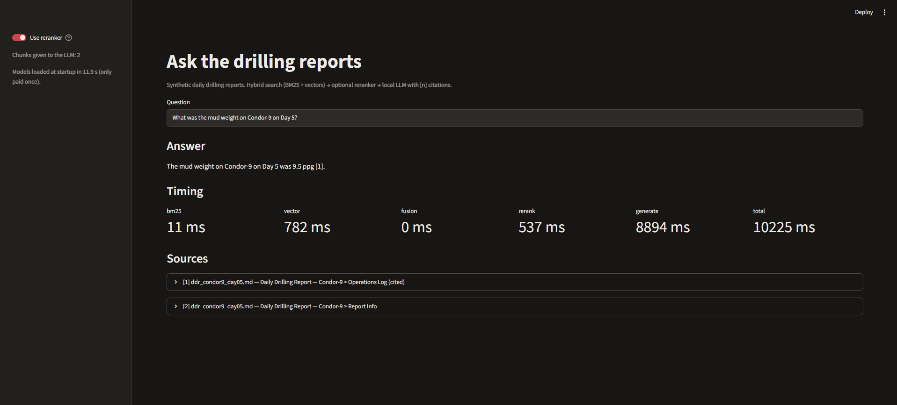
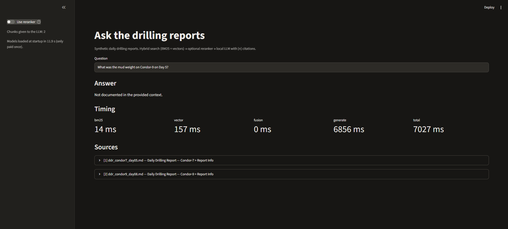

# rag-portfolio

A RAG ("ask my documents") system built from scratch in plain Python, with a focus on **measuring quality honestly** instead of just showing a demo.

It answers questions from a small set of drilling-report style documents, cites its sources, and is scored with an automated evaluation pipeline. Everything runs locally except the evaluation judge.

> **Status:** retrieval, reranking, cited generation and evaluation are working. Tracing, latency metrics and a code-level citation checker are working; CI regression gating is still to do (see [Roadmap](#roadmap)).

> **Key results**
> - **Hit@2 on 40 answerable questions: plain hybrid 0.68 -> BM25-weighted hybrid + reranker 1.00** (chunk headers are on in both): BM25 weighting lifts it to 0.80, and adding the reranker takes it to 1.00.
> - **RAGAS faithfulness** (30 questions, judge gpt-oss-20b): 0.84 without and 0.88 with the reranker. No measurable difference; the judge is noisy.
> - **The eval caught a hidden bug:** prompts were being silently cut off. It is [now fixed and guarded](#the-eval-caught-a-hidden-bug-prompts-were-being-cut-off).
> - **Runs locally on a 4 GB GPU** (only the eval judge is hosted), in plain Python: no LangChain or LlamaIndex in the core pipeline.
> - Read the [Known limitations](#known-limitations-and-findings) before quoting any number.

---

## Demo app

```bash
streamlit run app.py          # needs Ollama running locally
```

Type a question to see the answer, the cited chunks in expandable boxes (cited ones open by default), and per-stage timing. The sidebar toggle turns the reranker off, so you can see it matter live: for "What was the mud weight on Condor-9 on Day 5?" the reranker on finds the right report; off, hybrid search alone returns the look-alike Condor-7 report and the model answers "Not documented".

The embedder and reranker are loaded once and kept in RAM; they move to the GPU only while retrieving, then step aside so the LLM fits in 4 GB (measured: both on the GPU use 1.4 GB, which leaves too little for Ollama).


*Reranker on: both retrieved chunks come from the right report (Condor-9, Day 5) and the answer cites [1]. Reranking took about 0.5 s in this single run.*


*Reranker off, same question: hybrid search alone returns a look-alike report (Condor-7, Day 5) and a different day of Condor-9, so the model correctly says "Not documented in the provided context." Single runs; see the Latency table for typical timings.*

### Docker

Ollama runs on the **host**, not in the container. The image holds the app, the models and the index (CPU-only PyTorch, so the embedder and reranker run on the CPU inside the container; the LLM still uses your GPU through the host's Ollama).

```bash
docker build -t rag-portfolio .
docker run --rm -p 8501:8501 --add-host=host.docker.internal:host-gateway rag-portfolio
# then open http://localhost:8501
```

On the host, Ollama must accept connections from the container: start it with `OLLAMA_HOST=0.0.0.0 ollama serve` (by default it only listens on localhost). `OLLAMA_HOST` inside the container defaults to `http://host.docker.internal:11434`. `.env` is excluded from the image.

---

## How it works

```
Documents -> Chunk -> Embed (BGE) -> Chroma vector index
                  \-> BM25 keyword index

Question -> Hybrid retrieval (BM25 + vectors, fused with RRF)
         -> Cross-encoder reranker (BGE)
         -> Local LLM answers with [n] citations
```

| Step | File | What it does |
|---|---|---|
| Chunking | `ingest/chunk.py` | Splits markdown by headers and paragraphs, then packs into 480-token chunks with 80-token overlap. Keeps a header breadcrumb such as `Installation > Requirements`, and puts a one-line label (`[Condor-9 \| Day 5 \| Mud Properties]`) at the top of every chunk so a chunk from the middle of a long report still says which report it belongs to. |
| Embedding | `ingest/embed.py` | Embeds chunks with `BAAI/bge-base-en` and stores them in ChromaDB (cosine). Queries and documents are encoded separately. |
| Keyword index | `ingest/bm25_index.py` | Builds a BM25 index. Chunk IDs match the vector index so the two result lists can be fused. |
| Hybrid search | `retrieve/hybrid.py` | Runs BM25 and vector search separately (top 20 each), then fuses with Reciprocal Rank Fusion (k=60). Uses ranks only, because BM25 and cosine scores are not comparable. When the question contains an exact ID or number (`WO-98389`, `10,955`), BM25 gets weight 100 (see the ablation for why it has to be that large). |
| Reranking | `retrieve/rerank.py` | `BAAI/bge-reranker-base` re-scores the top 10 candidates together with the question and keeps the best. |
| Pipeline | `pipeline.py`, `main.py` | Chains search, rerank and generation, and frees the embedding model and reranker from GPU memory before the LLM loads. `main.py` is the command-line interface. |
| Generation | `generate/answer.py` | Sends the chunks to a local Ollama model as numbered context and asks it to cite `[n]` for each claim. A prompt too long for the context window is rejected with a warning, never silently cut. |
| Tracing | `observability/` | `tracer.py` times each stage (bm25, vector, fusion, rerank, generate) and writes one JSON line per query to `logs/traces.jsonl`. `python -m observability.metrics` prints p50/p95 per stage. `generate/citations.py` checks `[n]` citations in code. |
| Evaluation | `eval/` | Scores retrieval against gold evidence and answers with RAGAS (see below). |

**Why plain Python?** No LangChain or LlamaIndex for the core pipeline. Every step is written out so it can be read and explained line by line.

---

## Results

**RAGAS faithfulness.** Judge: `openai/gpt-oss-20b` on Groq. Same 30 questions for both setups (seed 42), k=2.

| Setup | Faithfulness (30 questions) | Hit@2 | Recall@2 | MRR |
|---|---|---|---|---|
| BM25-weighted hybrid | 0.84 | 0.80 | 0.70 | 0.79 |
| BM25-weighted hybrid + reranker | 0.88 | 1.00 | 0.96 | 0.96 |

Hit@2, Recall@2 and MRR are computed against gold evidence on all 40 answerable questions, with no LLM.

- **Faithfulness shows no measurable difference** between the two setups: 0.84 vs 0.88 is about one question and within the judge's noise. **The retrieval metrics show the reranker's advantage.**
- **Answer relevancy was not run** (it can score 0 on a correct "Not documented" answer).
- **Context precision and context recall are not LLM-scored**, because retrieval is measured against gold evidence.

Sources: `eval/ragas_scores.json`, `eval/results.csv`, `eval/ablation_results.csv`. See [Known limitations](#known-limitations-and-findings) before quoting the scores.

---

## Evaluation

The test corpus is **synthetic**: 40 fictional daily drilling reports (8 wells) plus one unrelated software doc, made by `scripts/generate_docs.py` with a fixed seed. It is built to be hard: look-alike wells (Condor-7/Condor-9, Falcon-1/Falcon-3), values that change every day, near-duplicate sentences, and 10 long reports that split into two chunks.

`eval/eval_set.json` has 45 questions (40 with gold evidence): single facts, look-alike wells, multi-hop (answer needs 2 chunks), "not documented" (tests hallucination), keyword-heavy (exact IDs and numbers), an `inference` question, one deliberately repeated question (for citation consistency), and two groups added later as checks on the first design (see below): 6 `keyword_holdout` and 9 `hard` questions (two wells or two days, look-alike numbers). Every answerable question carries gold evidence, so retrieval can be scored without an LLM.

The eval is a two-step process, because the 4 GB GPU cannot hold the embedding model, the reranker and the LLM at the same time:

1. `eval/run_retrieval.py` runs four setups for every question and saves the ranked chunks to `eval/retrieved.json`: **(a)** BM25 only, **(b)** vector only, **(c)** hybrid RRF, **(d)** hybrid + reranker, plus the BM25-weighted versions of (c) and (d).
2. `eval/ablation.py` computes the free retrieval metrics (hit rate@k, recall@k, MRR) for all setups, with no LLM, and writes `eval/ablation_results.csv` (the numbers from before headers/weighting are kept in `eval/ablation_results_baseline.csv`). `eval/ablate_headers.py` splits the gain between the two retrieval changes.
3. `eval/run_eval.py` generates answers for the two hybrid setups (`hybrid_weighted@2` and `hybrid_weighted_rerank@2`: BM25-weighted, without and with reranker, k=2 chunks; cached in `eval/generated.json`, `--generate-only` stops before any Groq call), then scores them with RAGAS. **The final run uses the LLM judge for one metric only, faithfulness**: is the answer supported by the retrieved text?

   - **Answer relevancy was not run.** It can score 0 on a correct "Not documented" answer.
   - **Context precision and context recall are not LLM-scored**: retrieval is measured against gold evidence instead (Hit@k, Recall@k, MRR), which is deterministic and cheaper.

   The script can score all four; `--metrics` picks which (default: all four). Faithfulness does not check whether an answer is correct or complete.

When several metrics are selected, each is scored for **both** setups before the next one starts, faithfulness first. Scores are stored per setup, metric and question, so running with different `--metrics` fills separate slots and never rescores or overwrites another metric. Every score is saved as soon as it arrives (`eval/ragas_scores.json`, also written as a table to `eval/results.csv`), so a rate-limit stop loses nothing. A per-minute limit waits and retries; a daily limit stops the script, and the same command continues later. Averages appear in `python -m eval.ablation` only once all questions of a setup are scored for that metric. Re-run it after any step to refresh the tables.

**Judge model: `openai/gpt-oss-20b` on Groq's free tier**, the same for both setups (RAGAS needs an LLM to grade answers), with local BGE embeddings for the relevancy metric. The model name is stored in `eval/ragas_scores.json`, `eval/results.csv` and `eval/ablation_results.csv`, and the script refuses to add scores from a different judge or question set to an existing file.

### Judge cost and commands

**The faithfulness run is done** (both setups, 30 questions). Answer relevancy was not run. The token costs below are **estimates made before the run**, from the answers as they were before the truncation fix; actual token usage was not recorded. Input tokens were counted from the RAGAS prompts; output tokens (including the model's hidden reasoning) were assumed to be 250 / 500 / 1,000 per call.

| Metric | Judge calls | Estimate: low | Estimate: expected | Estimate: high | Status |
|---|---|---|---|---|---|
| Faithfulness | 120 | 146k | 176k | 236k | done |
| Answer relevancy | 60 | 41k | 56k | 86k | not run |

The judge model's free tier allows 200,000 tokens per day.

```bash
# no Groq calls: cost estimate, then the questions and progress
python -m eval.estimate_cost --subset 30 --seed 42 --metrics faithfulness
python -m eval.run_eval --subset 30 --seed 42 --metrics faithfulness --list

# faithfulness (uses Groq; skips scores already saved in eval/ragas_scores.json)
python -m eval.run_eval --subset 30 --seed 42 --metrics faithfulness

# tables, no Groq calls
python -m eval.ablation
```

If the daily limit stops a scoring command, run the same command again after the quota resets.

### The 30-question subset

To save quota, RAGAS runs on 30 of the 45 questions: `--subset 30`, a random sample with fixed seed 42 (not stratified, so category counts are uneven; for example, the `inference` question is not in it). Free retrieval metrics still use all 40 answerable questions.

<details>
<summary>The 30 questions</summary>

1. `q01` (single_fact) What was the mud weight on Condor-7 on Day 4?
2. `q02` (single_fact) What was the average rate of penetration on Falcon-1 Day 12?
3. `q03` (similar_wells) Was anyone injured on Condor-7?
4. `q06` (single_fact) Which well experienced downtime due to a cementing unit delay?
5. `q07` (single_fact) What safety incident occurred on Falcon-1 Day 12?
6. `q08` (single_fact) What was Falcon-1's mud weight on Day 13, and why was it increased?
7. `q09` (repeat) What was Falcon-1's mud weight on Day 13, and why was it increased?
8. `q14` (similar_wells) What was the mud weight on Condor-9 on Day 4?
9. `q15` (similar_wells) What was the average rate of penetration on Falcon-3 Day 12?
10. `q16` (similar_wells) What was the mud weight on Falcon-3 on Day 12?
11. `q17` (similar_wells) What was Harrier-2's mud weight on Day 2?
12. `q18` (similar_wells) Who prepared the Condor-9 report for Day 6?
13. `q20` (multi_hop) How many hours of non-productive time did Osprey-5 record in total on Day 8 and Day 9?
14. `q21` (multi_hop) Which day had the higher rate of penetration on Condor-9, Day 4 or Day 5, and by how much?
15. `q23` (not_documented) What was the H2S level recorded on Osprey-5?
16. `q26` (not_documented) What was the hole inclination at the end of Kestrel-4 Day 18?
17. `q27` (keyword) Which well and day used bit serial number BS-85748?
18. `q28` (keyword) What caused the downtime recorded under work order WO-98389?
19. `q30` (keyword) Which well and day reached a depth of 10,955 ft?
20. `q31` (keyword_holdout) Which well and day used bit serial number BS-67080?
21. `q32` (keyword_holdout) Which report is work order WO-17861 in, and what was the cause?
22. `q35` (keyword_holdout) Which report states an average rate of penetration of 20.9 ft/hr?
23. `q36` (keyword_holdout) Which report lists a mud weight of 12.1 ppg?
24. `q38` (hard) Which was drilling faster on Day 12, Falcon-1 or Falcon-3?
25. `q39` (hard) Which had the higher funnel viscosity on Day 12, Falcon-1 or Falcon-3?
26. `q40` (hard) Which had the higher chlorides on Day 13, Falcon-1 or Falcon-3?
27. `q41` (hard) Which had the higher mud weight on Day 5, Condor-7 or Condor-9?
28. `q42` (hard) What was the combined non-productive time of Falcon-1 and Falcon-3 on Day 12?
29. `q43` (hard) How many rig crew were on site in total on Day 12, counting Falcon-1 and Falcon-3?
30. `q44` (hard) By how much did Kestrel-4's mud weight change between Day 16 and Day 19?

</details>

---

## What each retrieval change contributed

The 2x2 below isolates the two changes (context headers on chunks, BM25-weighted RRF) on the 40 answerable questions (`python -m eval.ablate_headers`). "Keyword Hit@3" covers all 10 keyword questions.

Without the reranker:

| Variant | Hit@2 | Hit@3 | Recall@3 | MRR | Keyword Hit@3 |
|---|---|---|---|---|---|
| neither | 0.65 | 0.70 | 0.59 | 0.65 | 0.30 |
| weighting only | 0.75 | 0.82 | 0.71 | 0.73 | 0.80 |
| headers only | 0.68 | 0.82 | 0.71 | 0.71 | 0.60 |
| **both** | **0.80** | **0.90** | **0.79** | **0.79** | **0.90** |

With the reranker:

| Variant | Hit@2 | Hit@3 | Recall@3 | MRR | Keyword Hit@3 |
|---|---|---|---|---|---|
| neither | 0.88 | 0.88 | 0.80 | 0.84 | 0.70 |
| weighting only | 0.95 | 0.95 | 0.88 | 0.91 | 1.00 |
| headers only | 0.95 | 0.95 | 0.94 | 0.93 | 0.80 |
| **both** | **1.00** | **1.00** | **0.99** | **0.96** | **1.00** |

Reading it: each change helps on its own, the gains roughly add up, and the reranker adds a large gain on top of either. Headers help most when the answer sits in the second chunk of a long report (Recall@3 0.80 -> 0.94 with the reranker); weighting helps most on exact-ID questions.

**Hard questions** (9 questions that need two wells or two days; Recall counts both pieces of evidence): plain hybrid reaches Recall@2 0.50 and Recall@3 0.61; hybrid + reranker reaches 0.83 and 0.94. At k=2 the reranker still misses some second pieces of evidence, so k=3 is safer for multi-hop questions.

---

## Latency

Cold and warm are measured separately (`python scripts/measure_latency.py`, p50 / p95 in ms). Measured on this laptop (4 GB GPU) on 25 Nov 2026. Earlier measurements were slower. A single p95 over all queries would be dominated by model loading, so it would mislead.

| Stage | Cold: CLI, models reloaded every question (n=3) | Warm: app, models loaded once (n=10) |
|---|---|---|
| BM25 | 6 / 16 | 4 / 25 |
| Vector search | 2,742 / 4,376 | 32 / 76 |
| Rerank | 6,953 / 8,759 | 352 / 360 |
| Generate (LLM) | 5,935 / 6,244 | 4,665 / 6,503 |
| **Whole question** | **17,123 / 18,130** | **6,327 / 8,409** |

Loading the embedding model and reranker (paid once) took 7.0 s in the latency script and 11.9 s in the app (it varies). Warm retrieval is under 1 s. Generation is the largest warm stage; it includes loading the LLM, because Ollama unloads it after each answer so the next retrieval fits on the GPU. The whole-question time also includes time outside the listed stages. Small samples: treat these as orders of magnitude.

---

## Known limitations and findings

These are written down on purpose. A project that hides its problems cannot be trusted.

**Found by the eval and fixed (kept here so the numbers make sense)**

- **Chunks lost their context.** The second chunk of a long report (mud, downtime, safety) had no well name or day, so neither BM25 nor the embeddings could tell which report it came from. Fixed by putting a header on every chunk. Hit@2 for hybrid + reranker went from 0.84 to 0.96 (on the 25 answerable questions of the eval set at that time).
- **Plain RRF buried exact-ID matches.** BM25 alone finds exact IDs and numbers, but plain hybrid pushed them down. With k=60, neighbouring ranks score almost the same, so a modest BM25 weight (3, 5, even 10) changed nothing; it only worked from 30 up. The weight is now 100 for questions that contain an exact ID or number (reasoning: it has to exceed about 62). **The rule was designed while looking at the first 4 keyword questions.** To check for overfitting I added 6 new keyword questions afterwards and did not tune on them:

  | Hit / MRR | Plain hybrid | BM25-weighted hybrid |
  |---|---|---|
  | Design set (4 questions, rule fires on 4): Hit@2 / Hit@3 / MRR | 0.25 / 0.50 / 0.36 | 0.75 / 1.00 / 0.71 |
  | **Holdout (6 new questions, rule fires on 4): Hit@2 / Hit@3 / MRR** | 0.17 / 0.67 / 0.36 | **0.67 / 0.83 / 0.67** |

  So the gain holds up on new questions, but it is smaller than on the design set. The 2 holdout questions without an exact ID or number (a decimal ROP and a decimal mud weight) are not touched by the rule. Still only 10 questions in total.
- **Nothing told the model to say "I don't know".** With a "Not documented in the provided context." instruction, in the current answers each setup declines 4 of the 5 unanswerable questions (before the instruction: 1 of 5 cleanly). The software-doc question about `on_click` is the fifth: both setups still make claims about repeated clicks that the documentation does not make (hybrid also adds that the context does not mention them), probably because the 3B model sees related text and fills the gap.
- **Repeated questions differed between runs.** Ollama now runs at temperature 0 with a fixed seed. The question that appears twice in the eval set (`q08`, `q09`) has 4 identical answers across both copies and both setups.

#### The eval caught a hidden bug: prompts were being cut off

We looked into low faithfulness scores and found that the model had not read all of its input.

- **Bug.** `generate/answer.py` set `num_ctx` to 1024. On the 30-question subset, 7 prompts of the reranker setup were longer (the longest 1,297 tokens) and none of the setup without reranker. Ollama silently cut them to 514 evaluated tokens, dropping the start of the prompt (probably chunk `[1]`). Several answers then said the information was missing although retrieval had found it.
- **Invalid scores.** The first faithfulness scores, 0.78 (hybrid) and 0.70 (hybrid + reranker), do not compare the two setups: the reranker's score included answers to cut prompts.
- **After the fix**, no prompt in the subset is cut. 6 of the reranker's 30 answers changed, all among the 7 that had been cut (the seventh is a correct "Not documented"). 5 of the 6 became correct (`q41` answers indirectly: it says Condor-7 had the lower mud weight). `q39` stays wrong: the Falcon-3 Day 12 report it needs was not among the retrieved chunks. None of the 30 answers without the reranker changed.
- **Context size.** `NUM_CTX` is now 2560. On this 4 GB GPU, 4096 put 20% of the model on the CPU, and every size tested from 2624 to 4096 put 15-20% there; 2560 ran 100% on the GPU.
- **Guard.** The request sends `truncate: false`, so Ollama rejects an over-long prompt. A clear warning then appears in the trace log, the CLI and the app, and the eval stops without saving an answer. A second warning appears if a prompt leaves fewer than 512 tokens for the answer.
- **Fragile points.** Tested on Ollama 0.33.1 only; a server that ignores `truncate` would cut silently again. The Python client does not expose the option, so the code uses the client's private `_request` method, and a client or Ollama update could break it.
- **Old results** are kept as `eval/*_baseline_numctx1024.*`.

**Still open**

- **Small local model.** The machine has 4 GB of VRAM, so generation uses `llama3.2:3b`. Llama 3.1 8B ran out of memory, and a smaller model (`phi`) hallucinated badly. The 3B model sometimes leaves the `[n]` citation off; the citation checker flags these (see the eval output and `main.py` warnings). Missing citations in the current answers (k=2). A "decline" is an answer that says something is not documented in the provided context and cites nothing; it needs no citation.

  | | Hybrid, 45 questions | Hybrid + reranker, 45 questions | Hybrid, 30-question subset | Hybrid + reranker, 30-question subset |
  |---|---|---|---|---|
  | Missing citations | 1/45 (2.2%) | 2/45 (4.4%) | 1/30 (3.3%) | 2/30 (6.7%) |
  | Missing citations, declines left out | 1/32 (3.1%) | 2/38 (5.3%) | 1/21 (4.8%) | 2/27 (7.4%) |
  | Declines | 13/45 (28.9%) | 7/45 (15.6%) | 9/30 (30.0%) | 3/30 (10.0%) |
  | Answers containing "not documented in the provided context" (declines, plus partial answers that cite) | 14/45 (31.1%) | 8/45 (17.8%) | 10/30 (33.3%) | 4/30 (13.3%) |

  The counts include correct and wrong refusals. No answer cites a number that does not exist. Missing citations are under the 20% threshold set for adding a citation retry, so there is none.
- **Falcon-1 injury question is an inference, not a lookup.** Neither report says "no injuries" (Day 12: "no lost-time incidents", Day 13: "no incidents or near-misses"). Both setups now answer "Not documented in the provided context." At k=2, hybrid gives the model only one of the two reports (the other ranks third). Hybrid + reranker gives it both and it still declines, without saying what the reports do record, so there this is a reading weakness. It has its own category (`inference`) and was not tuned for.
- **Section labels are approximate.** A chunk's section label comes from its first block, so a chunk that spans several sections names only the first. Some citations name the wrong section.
- **The CLI reloads models on every question** (see [Latency](#latency)). The app avoids this by parking the models in RAM, but the LLM still has to unload after each answer so retrieval fits on the GPU, so generation always includes loading it.
- **Faithfulness shows no measurable difference between the two setups.** It is 0.84 without and 0.88 with the reranker. The gap is 1.25 question-points out of 30, about one question, and within the judge's noise (next point); per question, the reranker scores higher on 4 and lower on 4. The retrieval metrics do show the reranker's advantage (see [Results](#results)).
- **The judge is noisy.** None of the 30 hybrid answers changed with the truncation fix (same retrieved chunks too), yet their faithfulness went from 0.78 to 0.84: a swing of about 0.06 on the same answers, with 8 of the 30 scores different, some from 0 to 1 or 1 to 0. The judge's `max_tokens` setting (4096 in the code at first, now 16384) may also play a part; the saved scores do not record which limit was used. This is one pair of runs, not a measured error bar. In the first run, `q40` also got two different scores (0.67 and 0.50) for identical chunks and an identical answer; in the final run both are 0.50.
- **Faithfulness is not correctness.** `q39` with the reranker is still wrong but scores 0.67.
- **Answer relevancy was not run.** RAGAS can score it 0 when the judge calls an answer noncommittal, which can happen to a correct "Not documented in the provided context."
- **Context precision and context recall are not LLM-scored.** Retrieval is measured against gold evidence instead (Hit@k, Recall@k, MRR), which is deterministic and cheaper. These are not the same numbers as the RAGAS metrics: they check whether the gold evidence was retrieved and how high it ranked, not how much of the retrieved text is irrelevant. They also cover all 40 answerable questions, not the 30-question subset.
- **Groq free tier is a hard cap.** The judge model allows 200,000 tokens per day, so larger evaluations take several days. `eval/run_eval.py` resumes where it stopped.
- **The eval set is small.** 45 questions (40 with gold chunks): one question moves a hit rate by 2.5 points, and results on subsets of 4-10 questions are only indicative.
- **Synthetic data.** The reports are generated from templates, so wording is far more regular than real field reports.

---

## Data

The sample documents are **synthetic** (a fictional widget framework doc and made-up daily drilling reports). No real client or well data is in this repository.

---

## Setup

Requires Python 3.10+, [Ollama](https://ollama.com), and ideally an NVIDIA GPU.

```bash
git clone https://github.com/alphindas/rag-portfolio.git
cd rag-portfolio
python -m venv .venv
source .venv/bin/activate
pip install -r requirements.txt

ollama pull llama3.2:3b
```

The over-long-prompt guard was tested with Ollama 0.33.1 only. `NUM_CTX` (in `generate/answer.py`) is sized for a 4 GB GPU.

For evaluation, create a `.env` file with your free Groq API key:

```
GROQ_API_KEY=your_key_here
```

Generate the synthetic documents and eval questions (already committed, so this is optional; same seed gives the same files):

```bash
python scripts/generate_docs.py
```

Build the indexes (reads every `.md` file in `sample_docs/`), then ask a question:

```bash
python ingest/build_index.py
python main.py                                   # interactive
python main.py --question "What was the mud weight on Condor-7 on Day 4?"
```

Latency and citation statistics from the trace log (`logs/traces.jsonl`, written by every question):

```bash
python -m observability.metrics
```

Run the tests (no GPU, Ollama or API key needed):

```bash
pytest
```

Run the evaluation (run from the repo root):

```bash
python -m eval.run_retrieval     # GPU: embedder + reranker, then exits
python -m eval.ablation          # free retrieval metrics, no LLM
# Ollama generation + Groq-judged RAGAS (needs GROQ_API_KEY); see "Judge cost and commands"
python -m eval.run_eval --subset 30 --seed 42 --metrics faithfulness
python -m eval.ablation          # table again, now including RAGAS
```

---

## Roadmap

- [x] Chunking, embeddings, BM25 index
- [x] Hybrid retrieval with RRF fusion
- [x] Cross-encoder reranking
- [x] Local LLM generation with citations
- [x] RAGAS evaluation pipeline
- [x] Tracing and latency logging (p50 / p95)
- [ ] GitHub Actions: run the eval on every push and fail on quality regression
- [x] Code-level citation checker
- [x] Larger, harder synthetic corpus with gold evidence
- [x] Context headers on chunks, BM25-weighted fusion for exact IDs
- [x] Streamlit demo with reranker toggle and per-stage timing
- [x] Dockerfile (Ollama on the host)
- [x] RAGAS results table (faithfulness)
- [ ] Better chunk-level section labels

---

## Tech stack

Python, ChromaDB, `rank_bm25`, `sentence-transformers` (BGE embeddings and reranker), Ollama (`llama3.2:3b`), RAGAS, Groq (judge: `openai/gpt-oss-20b`).
